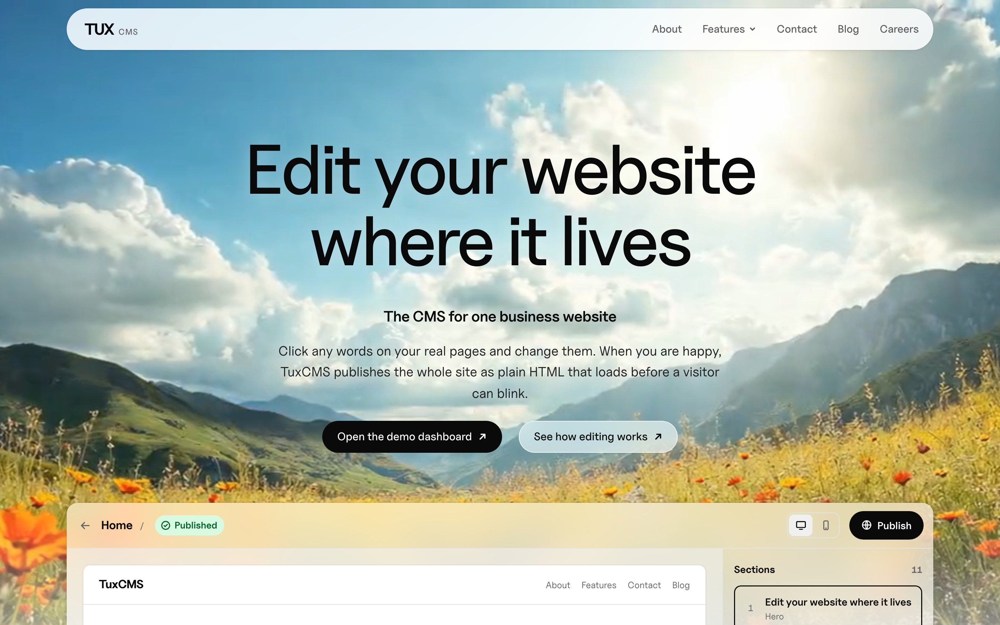
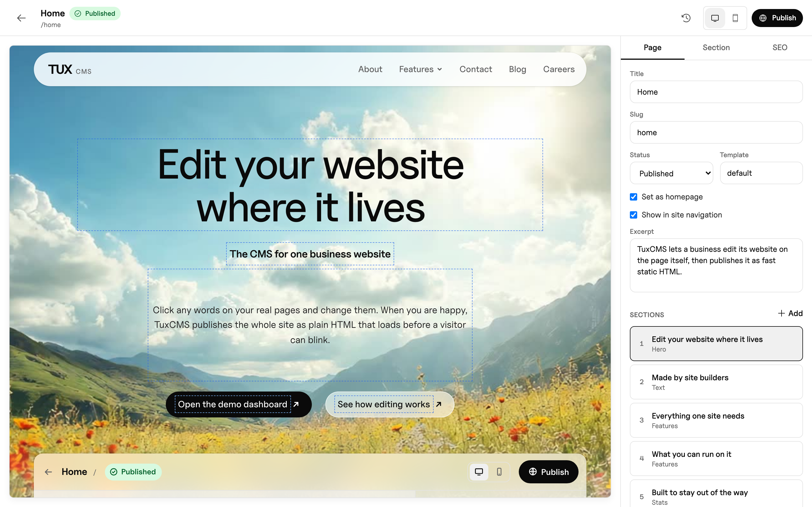
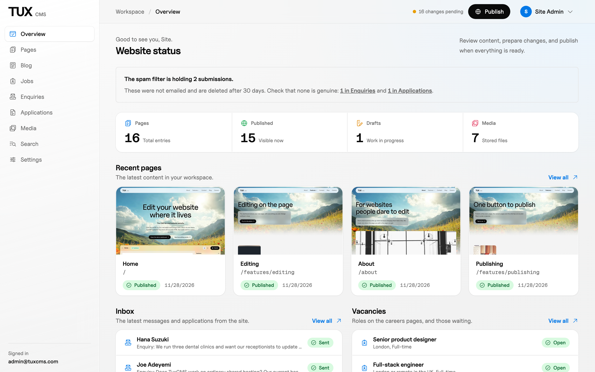
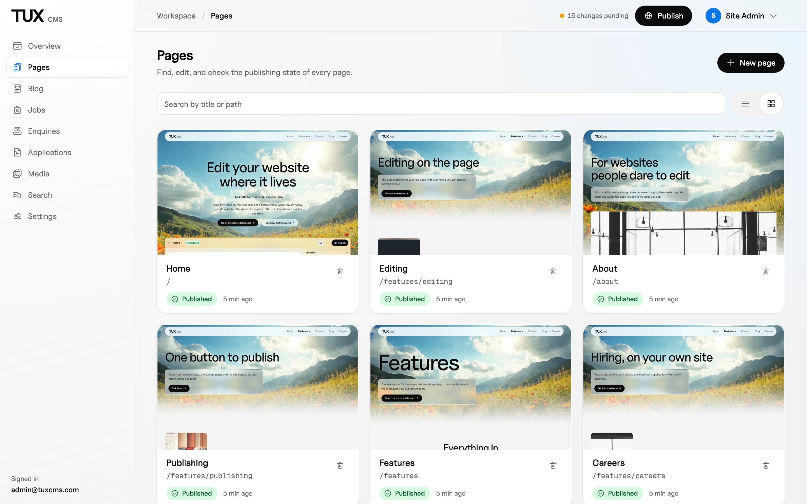
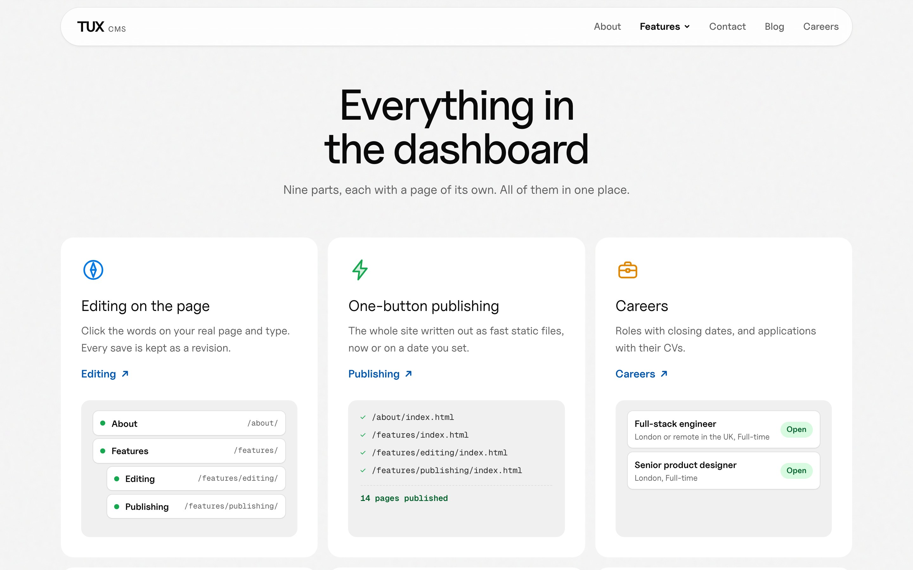
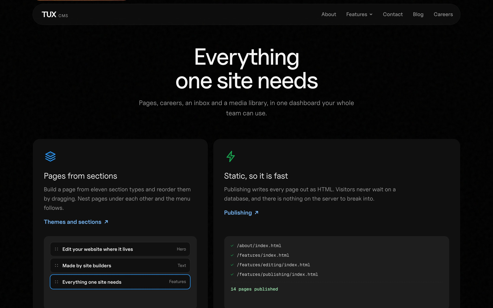

# TuxCMS

A content management system for one business website. Editors work in a React
dashboard, Laravel stores the content, and the site itself is published as plain
static HTML that visitors read without ever starting PHP.



| | |
| --- | --- |
|  |  |
| Every editable part of the real page is outlined and edited in place. | The Overview: recent pages, the inbox, vacancies and media. |
|  |  |
| Pages as a gallery of live thumbnails. | The bundled Shopfront theme: each feature card holds a live piece of the CMS. |

The theme follows the visitor's light or dark setting:



## How it fits together

Three parts share a single domain:

| Part | Source | Serves |
| --- | --- | --- |
| Laravel API | `app/`, `routes/api.php` | `/api/v1/*` and `/up` |
| Dashboard (React 19, Vite) | `dashboard/` | `/admin`, built into `public/admin` |
| Generated site | `resources/views/site/` | every other path, as files under `public/` |

`public/.htaccess` serves any request that matches a real file or directory
straight off disk, so only `/api/*` and `/up` ever reach Laravel. Publishing
runs `php artisan site:build`, which writes `index.html`, `about/index.html` and
so on, alongside `sitemap.xml`, `robots.txt`, `llms.txt` and `404.html`.

Pages are built from ordered sections (hero, features, stats, testimonials,
team, FAQ, call to action, contact, contact form, map, free text). A page whose
template is an installed theme is edited directly on the real rendered site in
the dashboard's live preview.

## Requirements

PHP 8.3 or newer, Composer, Node 20 or newer, and MySQL. SQLite is fine for
local work and is what the test suite uses.

## Getting started

```bash
composer install
npm install && npm --prefix dashboard install
cp .env.example .env && php artisan key:generate
php artisan migrate --seed
php artisan user:create
```

Three processes serve the three parts in development:

```bash
php artisan serve --port=8000
```

```bash
npm --prefix dashboard run dev
```

```bash
php -S 127.0.0.1:8080 -t public public/dev-router.php
```

The API answers on `:8000`, the dashboard on `:5173`, and the generated site on
`:8080`. `.claude/launch.json` holds the same three as named configurations.

## Publishing

```bash
php artisan site:build
```

The dashboard's Publish button calls the same build through
`POST /api/v1/site/publish`. Scheduled pages need cron, because nothing on a
static site notices that a `published_at` has matured:

```bash
* * * * * cd /path/to/tuxcms && php artisan schedule:run >> /dev/null 2>&1
```

That runs a build every fifteen minutes, a nightly rebuild at 03:30, and prunes
held spam at 03:10.

Once a blog post is published the build also writes the blog: a paged listing
at `/blog/`, a page per post, a page per tag at `/blog/tag/<tag>/` and an RSS
feed at `/blog/feed.xml`. Posts are written in the dashboard's Blog screen
with a Tiptap editor, and their HTML is cleaned by Symfony's HTML sanitizer
before it is stored.

## Themes

A theme is a directory of Blade views under
`resources/views/site/themes/<name>` with its static assets in
`public/themes/<name>`. Set `SITE_THEME` to choose one.

Shopfront is the theme a new install starts with, and the demo uses it as
TuxCMS's own product site. It is drawn with the dashboard's own tokens: the
same paper and ink, light or dark to match the visitor's device, Uncut Sans and
Geist Mono (both SIL Open Font License, bundled), and the dashboard's marker
colours. Its front page shows a working copy of the page editor holding that
very page: the words in its preview can be typed over, it switches between
desktop and phone widths, and Publish runs a mock build. Nothing in it is
saved. The theme renders every section type, the careers pages and the 404,
and its contact form delivers to the Enquiries inbox in the dashboard.
Features that carry photographs become a wall.

Its motion is written with [Motion](https://motion.dev) in
`resources/js/themes/shopfront.js` and bundled into the theme with
`npm run build:theme`. Nothing starts hidden, so the pages read the same with
the script switched off, and it stands down for visitors who ask for reduced
motion. The other
directory, `crystal`, is a client's website built on the CMS, not a theme to
reuse.

To try the whole thing on throwaway data, without touching your database or the
pages already built into `public/`:

```bash
bin/demo.sh
```

It serves the site, the dashboard at `/admin` and the API on one port, 8090.
The demo content is TuxCMS's own website and uses every part of the CMS: all
the section types, nested feature pages, photographs in the media library, a
draft and a scheduled page, vacancies in each status, and an inbox with
messages the spam filter is holding. Its uploads go to a directory of their own as well.

### A theme's own section types

Every theme can use the eleven built-in section types. A theme that needs
blocks of its own declares them in an optional `theme.json` beside its views:

```json
{
  "sections": {
    "packages": {
      "label": "Packages",
      "blurb": "Priced packages with what each includes.",
      "fields": {
        "title": { "type": "text", "label": "Heading" },
        "data.items": {
          "type": "list",
          "label": "Package",
          "item": {
            "name": { "type": "text", "label": "Name", "required": true },
            "features": { "type": "list", "label": "Included", "item": "text" },
            "url": { "type": "url", "label": "Booking link" }
          }
        }
      },
      "defaults": { "title": "Packages", "data": { "items": [] } }
    }
  }
}
```

The theme draws each one in `sections/<type-with-dashes>.blade.php` and marks
its fields as it would a built-in type's. Field types are `text`, `textarea`,
`richtext`, `url`, `image`, `number`, `boolean`, `select` (with `options`) and
`list` (of an object `item`, or of one of the single-value types). A page may
hold its theme's types only while that theme draws it, through its template or
`SITE_THEME`. The editor fetches each page's types from
`GET /api/v1/section-types?template=<template>` and builds its menu and side
panel from them. ARCHITECTURE.md has the details.

## Tests

```bash
php artisan test
```

```bash
npm --prefix dashboard run lint && npm --prefix dashboard run test:e2e
```

The PHP suite covers publishing, page revisions, reserved slugs, SEO output,
navigation, spam filtering and media import. The dashboard's Playwright specs
cover inline editing, image replacement, autosave and accessibility.

## Documentation

- [SETUP.md](SETUP.md) takes a fresh clone to a published page.
- [DEPLOYMENT.md](DEPLOYMENT.md) puts the whole thing on Spaceship shared hosting.
- [ARCHITECTURE.md](ARCHITECTURE.md) explains how it works and why.
- [API_DOCUMENTATION.md](API_DOCUMENTATION.md) is the endpoint reference.
- [INDEX.md](INDEX.md) maps the code: models, services, endpoints and commands.
- [TASKS.md](TASKS.md) tracks what is being worked on.
- [design.md](design.md) and [tokens.css](tokens.css) hold the dashboard's visual language.
